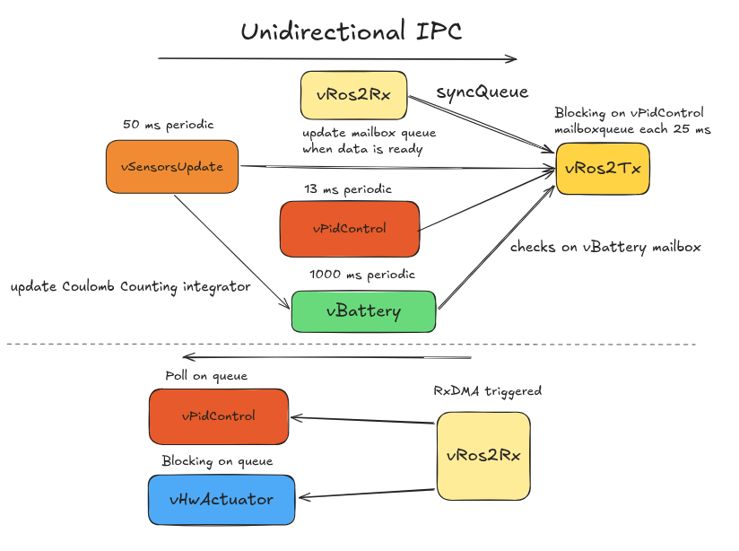
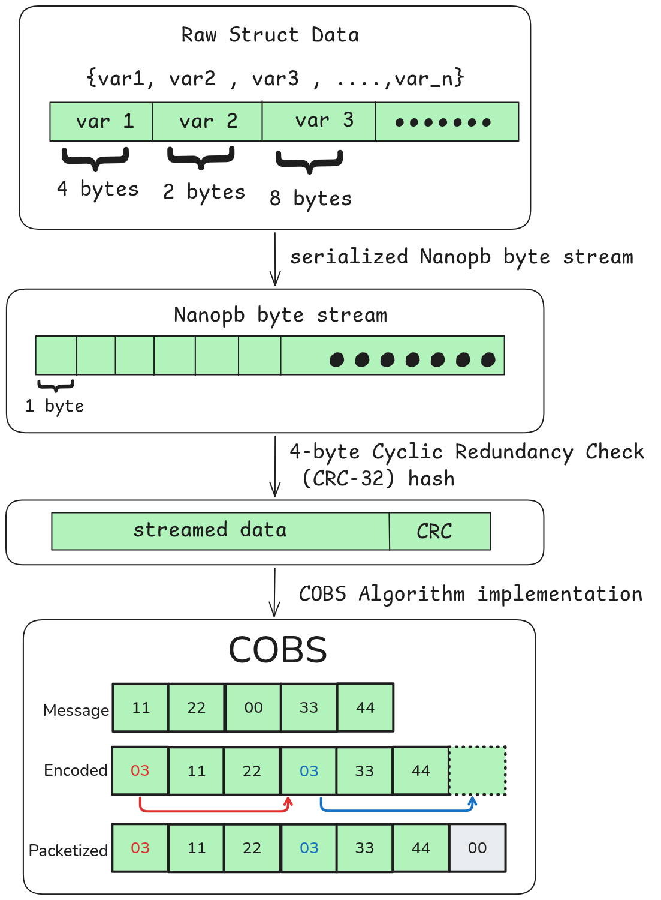
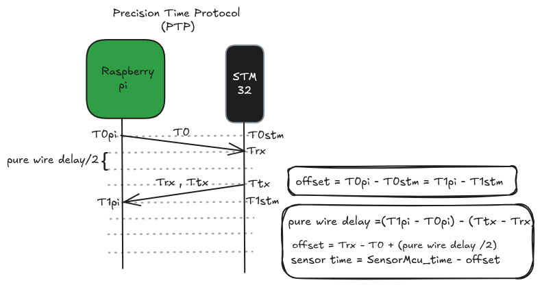

# AVCR Low-Level Control

Firmware for an autonomous vacuum-cleaning robot (AVCR): an STM32F411CEUx running
FreeRTOS, plus a ROS 2 bridge on the companion Raspberry Pi.

The firmware closes a wheel-speed loop, reads the robot's sensors, and exchanges
odometry, IMU, cliff and actuator data with the Pi over a single UART link using
protobuf messages framed with COBS and a CRC32.

## Repository layout

| Path | Contents |
| --- | --- |
| `avcrLowLevelCotrol/Core/` | Application code: tasks, drivers, protocol, PID, odometry |
| `avcrLowLevelCotrol/Drivers/` | Vendor STM32F4 HAL and CMSIS |
| `avcrLowLevelCotrol/Middlewares/` | FreeRTOS kernel and CMSIS-RTOS v2 |
| `avcrLowLevelCotrol/STM32F411CEUX_*.ld` | Linker scripts (flash and RAM builds) |
| `proto/` | Message schemas, generated nanopb/Python code, ROS 2 bridge |
| `compile_commands.json` | Generated compile database for clangd (not tracked) |

## Hardware

| Function | Part | Interface |
| --- | --- | --- |
| MCU | STM32F411CEUx | — |
| Drive motors | 2× brushed DC, direction GPIO + PWM | `TIM1_CH1` (right), `TIM1_CH2` (left) |
| Encoders | Quadrature, 11 PPR × 90:1 gearbox | `TIM3_CH1/CH2` (left), `TIM4_CH1/CH2` (right) |
| IMU | MPU6500 | `I2C1` |
| Cliff sensors | 4× VL6180X ToF, addresses `0x30`–`0x33` set via `XSHUT` | `I2C1` |
| Current / voltage | ACS758 Hall sensor + battery divider | `ADC1` (PA4, PA5) |
| Vacuum | BLDC ESC, 50 Hz hobby PWM (1.0–2.0 ms) | `TIM3_CH4` |
| Side brushes | 2× relays | PB14, PB15 |
| Companion link | UART, 115200 8N1 | `USART2` (PA2/PA3) with DMA |
| Ultrasonic | SR05 | `USART6` (PA11/PA12) |
| Time base | Free-running counter used as µs timestamp | `TIM2` |

Robot geometry and encoder constants live in `Core/Inc/timerEncoder.h`:
wheel radius 32.5 mm, wheelbase 150 mm, 11 PPR, 90:1 gear ratio,
RPM smoothing factor 0.2.

## Architecture

FreeRTOS tasks, created in `Core/Src/main.c`:

| Task | Period / trigger | Priority | Stack | Responsibility |
| --- | --- | --- | --- | --- |
| `PIDTask` | 13 ms (`vTaskDelayUntil`) | High3 | 4 KB | Update odometry, run both wheel PID+feed-forward loops, drive PWM |
| `SensorTask` | 50 ms | High1 | 4 KB | Read MPU6500, read 4× VL6180X, evaluate cliff state |
| `RosTx` | odometry mailbox | AboveNormal7 | 5 KB | Pack `TxMsg`, CRC32, COBS, DMA transmit |
| `RosRx` | UART idle DMA callback | AboveNormal5 | 5 KB | De-fragment, COBS decode, CRC check, decode `RxMsg` |
| `ActuatorTask` | actuator mailbox | Normal7 | 2 KB | Vacuum ESC state and side-brush relays |
| `BatteryTask` | — | Normal6 | 2 KB | Reserved for coulomb counting (not implemented) |
| `defaultTask` | 1 ms | Normal | 512 B | Idle placeholder |

Data flow uses one-slot overwrite mailboxes (`osMessageQueueNew(1, …)`), so the
consumer always sees the freshest sample: `sensorMailboxQueue`, `odomMailboxQueue`,
`rpmCmdMailboxQueue`, `actuatorCmdMailboxQueue`, `syncMsgMailbox`,
`batterySocMailboxQueue`, `coulombCntIntgMailboxQueue`. A `CRCMutex` serializes
access to the shared CRC peripheral.



*Task and IPC data flow. The upper half is the telemetry path (unidirectional
mailboxes into `vRos2Tx`), the lower half is the command path (`vRos2Rx` pushing
into `vPidControl` and `vHwActuator`).*

## Serial protocol

Every frame on `USART2` is:

```
COBS( protobuf payload || CRC32(payload) ) | 0x00
```

- Payloads are nanopb-encoded `TxMsg` (STM32 → Pi) and `RxMsg` (Pi → STM32).
- `CRC32` is the MPEG-2 variant produced by the STM32 hardware CRC unit.
- COBS removes `0x00` from the body so a single trailing zero byte is an
  unambiguous frame delimiter.
- The STM32 receives with circular DMA plus idle-line interrupt; the Pi uses
  `pyserial` with the same framing.

Schemas: `proto/tx.proto`, `proto/rx.proto`. Generated files are checked in under
both `proto/` (Python + C) and `avcrLowLevelCotrol/Core/` (C only).

### Communication protocol



The pipeline, in order: the C struct is serialized to a compact nanopb byte
stream, a 4-byte CRC-32 is appended, then COBS replaces the zero bytes and the
frame is terminated with a single `0x00` delimiter. No `0x00` can appear inside
the encoded body, so the receiver can resynchronize after a dropped byte simply
by discarding everything up to the next delimiter.

### Time synchronization



The bridge estimates the offset between the Pi clock and the STM32 microsecond
counter so sensor timestamps can be converted into the Pi's time base:

- `T0`, `Trx`, `Ttx` and `T1pi` are captured on each sync exchange and carried in
  the `syncMsgRx` / `syncMsgTx` protobuf fields.
- `pure wire delay / 2` is the one-way link latency implied by the round trip.
- `offset = Trx - T0 + (pure wire delay / 2)`, so a sample taken at
  `SensorMcu_time` is reported on the Pi as `SensorMcu_time - offset`.

On the STM32, `RosRx` stores the last Pi timestamp in `syncMsgMailbox` and `RosTx`
stamps `stm32_tx_time_stamp_us` on the outgoing message.

## Building and flashing

The project can be built either from STM32CubeIDE (the canonical configuration in
`.cproject`) or from the command line with CMake.

### CMake

Two presets are provided: `host` (libraries, CLI and unit tests on the PC) and
`firmware` (cross-compiled image for the STM32F411). The firmware toolchain is
discovered from an STM32CubeIDE installation under `/opt/st`; override it with
`-DARM_TOOLCHAIN_BIN=/path/to/bin` or the `ARM_TOOLCHAIN_BIN` environment
variable.

```bash
cmake --preset host
cmake --build --preset host
ctest --preset host

cmake --preset firmware
cmake --build --preset firmware
```

Firmware artifacts are written to `build/firmware/avcr_firmware.{elf,bin,hex}`.

### Host CLI

`build/host/avcr-cli` reuses the firmware's COBS, nanopb, PID and odometry
sources, so frames captured on the wire can be inspected and generated offline:

```bash
avcr-cli frame-encode 08960112041f     # CRC + COBS frame from raw payload
avcr-cli frame-decode <hex-frame>      # validate and print the payload
avcr-cli tx-demo                       # sample TxMsg frame
avcr-cli rx-demo                       # sample RxMsg frame
avcr-cli tx-decode <hex> [tx|rx]       # decode a frame into protobuf fields
avcr-cli pid-step --steps 400          # simulated PID step response as CSV
```

### STM32CubeIDE

1. Open STM32CubeIDE and import `avcrLowLevelCotrol` as an existing project.
2. Select the `Debug` or `Release` configuration defined in `.cproject`.
3. Build (`Project ▸ Build`), then flash with ST-LINK (`Run ▸ Debug` or the
   `.launch` configuration).

`compile_commands.json`, `.cache/` and `build/` are regenerated and are
intentionally not tracked.

## Running the ROS 2 bridge

On the Pi:

```bash
pip install pyserial cobs crccheck protobuf
PYTHONUNBUFFERED=1 python3 proto/ros2serialbridge.py
```

The node exposes `cmd_vel`, `odom` and `imu`, with serial port and baud rate as
ROS parameters (`serial_port`, `baudrate`). See `proto/README.md` for example
commands.
